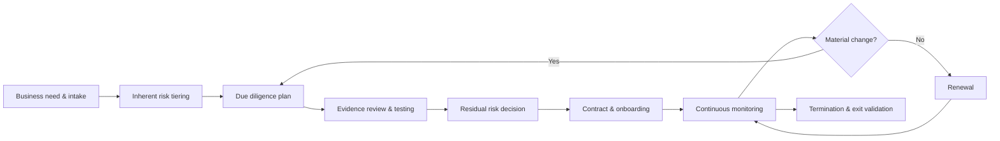

# Enterprise Third-Party Risk Management Program

A GitHub-ready, risk-based Third-Party Risk Management (TPRM) program for organizations that acquire cloud, endpoint security, SaaS, managed services, and other technology services.

> **Important:** The named endpoint-security companies in this repository are an illustrative assessment universe. Inclusion does not constitute endorsement, certification, or a product ranking. Assessments must be based on current evidence, contractual scope, deployment architecture, and organizational risk appetite.

## Start here: project in plain language

**The problem:** Organizations rely on outside technology vendors, but need consistent evidence before accepting the security and operational risks.

**The solution demonstrated:** This repository provides a sample vendor-risk program: policy and governance documents, questionnaires, an assessment methodology, sample cases, and Python-based scoring and validation tools.

**The workflow:**

```text
Request a vendor → Set initial risk level → Review evidence → Decide and document → Monitor
```

**A quick tour:**
1. Open the [risk methodology](docs/risk-methodology.md) to understand how risk decisions are made.
2. Look at the [vendor intake questionnaire](templates/vendor-intake-questionnaire.md) to see what information is requested.
3. Read the **Quick start** section below to try the scoring helper.
4. Explore the [endpoint-security assessment standard](assessments/endpoint-security/assessment-standard.md) as a detailed example.

**Portfolio skills:** Vendor and supply-chain risk, governance, audit evidence, risk decision records, Python scoring, and documentation.

**Boundaries:** This is an illustrative reference program, not evidence of completed audits of named companies. A score supports, but never replaces, professional judgment or organizational approval.

## Program objectives

- Establish accountable governance for third-party and supply-chain risk.
- Apply consistent inherent-risk tiering and evidence-based due diligence.
- Identify cybersecurity, privacy, resilience, legal, financial, operational, geopolitical, AI, concentration, and fourth-party risks.
- Embed risk requirements in sourcing, contracting, onboarding, monitoring, incident response, renewal, and termination.
- Provide repeatable analyst workflows, decision records, metrics, and auditable evidence.
- Add a deep-dive module for endpoint-security vendors with privileged agents and cloud control planes.

## Repository map

| Path | Purpose |
|---|---|
| `docs/` | Charter, operating model, methodology, lifecycle, RACI, metrics, roadmap and references |
| `policies/` | Formal TPRM policy |
| `procedures/` | Intake through termination procedures and issue management |
| `templates/` | Intake, questionnaires, risk acceptance, findings, monitoring and contracting templates |
| `assessments/endpoint-security/` | Endpoint vendor assessment standard and ten company case profiles |
| `data/` | Risk taxonomy, control mappings, JSON schema and illustrative vendor register |
| `tools/` | Python scoring utility and repository validator |
| `tests/` | Automated tests for scoring logic |
| `.github/workflows/` | Repository quality checks |

## Lifecycle



## Decision model

1. **Inherent risk** is evaluated before controls are considered.
2. **Control effectiveness** is supported by evidence quality and testing.
3. **Residual risk** drives approval, remediation, compensating controls, acceptance, or rejection.
4. No mathematical score overrides mandatory prohibitions, legal obligations, sanctions, unacceptable architecture, or executive risk appetite.

## Quick start

1. Approve the charter, policy, risk appetite, RACI, and escalation thresholds.
2. Import `data/vendor-register.csv` into the organization’s GRC platform.
3. Use `templates/vendor-intake-questionnaire.md` for every new engagement.
4. Apply `docs/risk-methodology.md` and the calculator:

```bash
python tools/risk_score.py --likelihood 4 --impact 5 --control-effectiveness 0.55 --evidence-confidence 0.8
```

5. For EDR/EPP/XDR providers, apply `assessments/endpoint-security/assessment-standard.md`.
6. Track exceptions and findings through closure; monitor critical vendors continuously.

## Framework alignment

The program is designed around NIST CSF 2.0, NIST SP 800-161 Rev. 1 Update 1, NIST SP 800-53 Rev. 5 supply-chain controls, NIST SP 800-218 SSDF, CISA ICT SCRM resources, ISO/IEC 27001/27036 concepts, SOC 2, privacy obligations, and resilience practices. Organizations must tailor mappings to their legal and regulatory context.

## Repository quality

The GitHub workflow runs scoring unit tests, verifies JSON/CSV and Python syntax, checks relative Markdown links, and confirms required artifacts exist. See `CONTRIBUTING.md` and `SECURITY.md`.

## License

Apache-2.0. This program is educational and must be reviewed by qualified legal, privacy, procurement, cybersecurity, and business-continuity personnel before operational use.
